<!-- 星陨 · XingYunStar 个人主页 README（炫酷版 / 深色主题）
     已发布：https://github.com/XingYunStar/XingYunStar
     说明：流萤.love 的链接用 punycode（xn--qzw410c.love），纯 ASCII 更稳；
           想改配色把 fde047 / f59e0b（琥珀）/ ff6b9d（粉）换掉，header 的 color=0:...,50:...,100:... 同步改 -->

 

---

## ⚡ 在做什么

> 把机器人调教到能在群里好好干活。

围绕 **QQ 机器人生态** 写插件，AstrBot 与 NapCat 两条线并行。三条自我要求：

- 🪶 **零多余依赖** —— 抖音签名纯 Python 实现，不用再装 Node.js
- 📦 **开箱即用** —— 背单词、站点统计都是零第三方依赖，下载就能跑
- 🖱️ **有界面就别翻配置** —— 插件自带 WebUI，装完点两下就行

---

## 🧩 精选项目

<table>
<tr>
<td width="50%" valign="top">

### ✨ 流萤.love 同人站

非官方流萤主题同好站：角色资料、图集、动态都收在里面。一个人做不完，欢迎提 PR 一起把它补完。

[`FireflyLoveSite`](https://github.com/FireflyDevs/FireflyLoveSite)

</td>
<td width="50%" valign="top">

### 📊 站点流量统计

Nginx 访问日志统计 WebUI：请求数、流量、IP、UV / PV，日/周/月与总览切换，支持原始日志检索，零第三方依赖。

[`site-stats`](https://github.com/XingYunStar/site-stats)

</td>
</tr>
<tr>
<td width="50%" valign="top">

### 🤖 官方机器人适配器

TRSS-Yunzai 的 QQBot 适配器（qq-official-bot 版），兼容旧版 QQBot-Plugin。

[`qq-official-bot-plugin`](https://github.com/XingYunStar/qq-official-bot-plugin)

</td>
<td width="50%" valign="top">

### 🎬 抖音订阅推送

订阅抖音账号，新作品自动进群：图文发图片、视频发视频。纯 Python 签名，自带 WebUI。

[`astrbot_plugin_douyin_subscribe`](https://github.com/XingYunStar/astrbot_plugin_douyin_subscribe)

</td>
</tr>
</table>

还有 · [考研背单词](https://github.com/XingYunStar/kaoyan-vocab) · [屏蔽官方机器人](https://github.com/XingYunStar/astrbot_plugin_block_official_bot) · [插件导入器](https://github.com/XingYunStar/napcat-plugin-importer) · [禁言列表](https://github.com/XingYunStar/napcat-plugin-mute-list) · [禁言恢复](https://github.com/XingYunStar/napcat-plugin-mute-recover) · [自动同意加群](https://github.com/XingYunStar/astrbot_plugin_group_invite_auto_approve) · [部署教程](https://github.com/XingYunStar/bot)

---

## 🤝 开源贡献

上游 · [SnowLuma #491](https://github.com/SnowLuma/SnowLuma/pull/491) 群简介与群备注拆分 · [#612](https://github.com/SnowLuma/SnowLuma/pull/612) 自邀请请求保持可处理 · [社区插件索引](https://github.com/HolyFoxTeam/napcat-plugin-community-index) 11 次上架与版本更新

---

## 🛠 技术栈

---

##  流萤

因为喜欢流萤，顺手做了两个站：

- **[likefirefly.com](https://likefirefly.com)** —— 流萤厨的导航站：角色资料、图集、动态，都在这里收着
- **[流萤.love](https://xn--qzw410c.love)** —— 想认真做好的同人站，一个人时间和精力不够，**正在找同好一起做**，会前端 / 后端 / UI 都欢迎

---

## 🧬 语言

---

## 📈 数据

  

---

**插件有问题 → 直接去对应仓库开 Issue，比私信快。**

 

